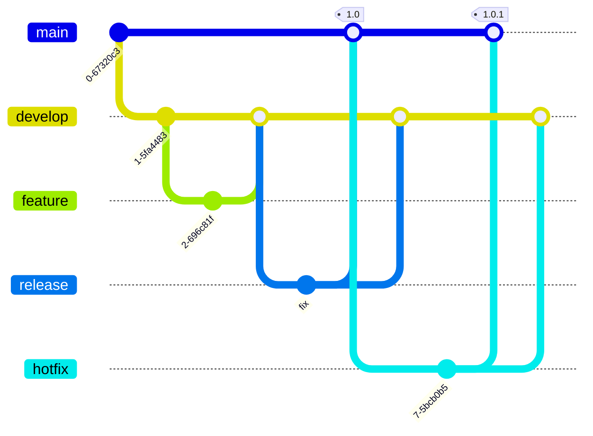

---
sources:
  - resource: "https://nvie.com/posts/a-successful-git-branching-model/"
---

#[[Continuous Integration]]

[[Git]] のブランチ戦略。develop と master（main）を常設ブランチとし、master が本番環境相当になる。Vincent Driessen が2010年に提唱した

- リリース直前の修正はリリースブランチ上で行い、master と develop の両方へマージで戻す。トランクで直してリリースブランチへ cherry-pick する [[トランクベース]] とは向きが逆
- 作者自身が2020年に、継続的にデリバリーする Web アプリには GitHub flow のような単純な流れを勧め、Git flow は明示的にバージョンを付けるソフトウェアや複数バージョンを並行で支える場合に合うとした
